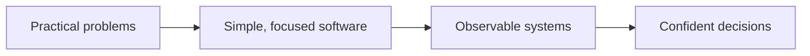

# Quantum Axis

### The Axis of Infinite Intelligence

**We build practical software for complex systems.**

[Projects](#-our-work)　·　[Approach](#-how-we-build)　·　[Technology](#-technology)　·　[Contact](#-connect)

---

## ◈ Our work

We turn complex infrastructure into tools that feel clear, useful, and approachable. Our current focus is **network visibility**: helping teams understand connectivity, spot problems, and act with confidence.

<table>
<tr>
<td width="50%" valign="top">

### [Qnetward ↗](https://github.com/Quantum-Axis/Qnetward)

**Real-time network diagnostics. Self-hosted by design.**

Probe connectivity, inspect DNS, follow live latency, and keep searchable history in one workspace.

[Open the project](https://github.com/Quantum-Axis/Qnetward) · [Launch Qnetward](https://qnetward.moparapairayat.one)

</td>
<td width="50%" valign="top">

**DIAGNOSE** · ICMP, TCP, port scans, DNS 
**OBSERVE** · Live streams, charts, target health 
**OPERATE** · History, exports, alerts, workspaces 
**OWN** · Self-hosted API, dashboard, and data

</td>
</tr>
</table>

## ◉ Our Team

<table width="100%">
<tr>
<td align="center" width="25%">
   
  <strong><a href="https://github.com/Fatemabintemariam">Fatema Binte Mariam</a></strong> 
  Qnetward contributor
</td>
<td align="center" width="25%">
   
  <strong><a href="https://github.com/Moparapairayat">Mopara Pair Ayat</a></strong> 
  Organization member
</td>
<td align="center" width="25%">
   
  <strong><a href="https://github.com/monabber444">Monabber Eaman</a></strong> 
  Qnetward contributor
</td>
<td align="center" width="25%">
   
  <strong><a href="https://github.com/OrhanAsantr">Orhan Asan</a></strong> 
  Qnetward contributor
</td>
</tr>
</table>

## ◉ How we build

We value clear interfaces, useful defaults, and infrastructure our users can control. Each project should make a real operational task easier to understand and complete.

## ⌘ Technology & Capability Stack

A broad organization-level map of the technologies and domains represented across our work. Qnetward’s current production stack is called out separately below.

### ⚡ Core Engineering

<table>
<tr>
<td align="center" width="14%"> <strong>JavaScript</strong></td>
<td align="center" width="14%"> <strong>TypeScript</strong></td>
<td align="center" width="14%"> <strong>Python</strong></td>
<td align="center" width="14%"> <strong>Rust</strong></td>
<td align="center" width="14%"> <strong>Go</strong></td>
<td align="center" width="14%"> <strong>C++</strong></td>
<td align="center" width="14%"> <strong>C</strong></td>
</tr>
<tr>
<td align="center" width="14%"> <strong>Java</strong></td>
<td align="center" width="14%"> <strong>Kotlin</strong></td>
<td align="center" width="14%"> <strong>Swift</strong></td>
<td align="center" width="14%"> <strong>Dart</strong></td>
<td align="center" width="14%"> <strong>Scala</strong></td>
<td align="center" width="14%"> <strong>Lua</strong></td>
<td align="center" width="14%"> <strong>Haskell</strong></td>
</tr>
</table>

Systems Programming · Compilers · Runtime Engineering

### 🧩 Frontend · Web Experience

<table>
<tr>
<td align="center" width="14%"> <strong>React</strong></td>
<td align="center" width="14%"> <strong>Next.js</strong></td>
<td align="center" width="14%"> <strong>Vue</strong></td>
<td align="center" width="14%"> <strong>Nuxt</strong></td>
<td align="center" width="14%"> <strong>Svelte</strong></td>
<td align="center" width="14%"> <strong>Astro</strong></td>
<td align="center" width="14%"> <strong>Tailwind CSS</strong></td>
</tr>
<tr>
<td align="center" width="14%"> <strong>Three.js</strong></td>
<td align="center" width="14%"> <strong>GraphQL</strong></td>
<td align="center" width="14%"> <strong>Webpack</strong></td>
<td align="center" width="14%"> <strong>Vite</strong></td>
<td align="center" width="14%"> <strong>Redux</strong></td>
</tr>
</table>

WebGPU · Motion UI · Edge Rendering · Streaming UI · Reactive Systems

### 🧠 AI · AGI · Autonomous Systems

<table>
<tr>
<td align="center" width="14%"> <strong>Python</strong></td>
<td align="center" width="14%"> <strong>TensorFlow</strong></td>
<td align="center" width="14%"> <strong>PyTorch</strong></td>
<td align="center" width="14%"> <strong>OpenCV</strong></td>
<td align="center" width="14%"> <strong>scikit-learn</strong></td>
</tr>
</table>

OpenAI · Gemini · Claude · LangChain · LlamaIndex · CrewAI · AutoGen · AI Agents · Multi-Agent Systems · RAG Pipelines · Fine Tuning · Prompt Engineering · Agentic Workflows · LLMOps · Neural Search · Multimodal AI · Evals · Model Monitoring · Edge AI

### ☁️ Cloud Native · Platform Engineering

<table>
<tr>
<td align="center" width="14%"> <strong>AWS</strong></td>
<td align="center" width="14%"> <strong>Google Cloud</strong></td>
<td align="center" width="14%"> <strong>Azure</strong></td>
<td align="center" width="14%"> <strong>Cloudflare</strong></td>
<td align="center" width="14%"> <strong>Docker</strong></td>
<td align="center" width="14%"> <strong>Kubernetes</strong></td>
<td align="center" width="14%"> <strong>Terraform</strong></td>
</tr>
<tr>
<td align="center" width="14%"> <strong>Linux</strong></td>
<td align="center" width="14%"> <strong>Nginx</strong></td>
<td align="center" width="14%"> <strong>Prometheus</strong></td>
<td align="center" width="14%"> <strong>Grafana</strong></td>
<td align="center" width="14%"> <strong>Jenkins</strong></td>
</tr>
</table>

Cloud Native · Microservices · Event Driven · Service Mesh · GitOps · DevSecOps · Observability · OpenTelemetry · Edge Computing · Serverless · Cost Optimization · Incident Response · Release Automation

### 🗄️ Distributed Data Systems

<table>
<tr>
<td align="center" width="14%"> <strong>PostgreSQL</strong></td>
<td align="center" width="14%"> <strong>MySQL</strong></td>
<td align="center" width="14%"> <strong>MongoDB</strong></td>
<td align="center" width="14%"> <strong>Redis</strong></td>
<td align="center" width="14%"> <strong>Firebase</strong></td>
<td align="center" width="14%"> <strong>Cassandra</strong></td>
<td align="center" width="14%"> <strong>Elasticsearch</strong></td>
</tr>
<tr>
<td align="center" width="14%"> <strong>Kafka</strong></td>
<td align="center" width="14%"> <strong>RabbitMQ</strong></td>
<td align="center" width="14%"> <strong>Supabase</strong></td>
<td align="center" width="14%"> <strong>SQLite</strong></td>
</tr>
</table>

Vector Databases · Qdrant · Neo4j · NATS · Apache Spark · Data Lakes · Pinecone · Weaviate

### 🔐 Cybersecurity · Zero Trust

<table>
<tr>
<td align="center" width="14%"> <strong>Linux</strong></td>
<td align="center" width="14%"> <strong>Cloudflare</strong></td>
<td align="center" width="14%"> <strong>Docker</strong></td>
<td align="center" width="14%"> <strong>GitHub Actions</strong></td>
</tr>
</table>

Zero Trust · OWASP · Threat Modeling · Penetration Testing · Encryption · OAuth 2.0 · JWT · WAF · Supply Chain Security · Secrets Hygiene · IAM Boundaries

### ⚡ EEE · Embedded AI · Cyber-Physical Systems

<table>
<tr>
<td align="center" width="14%"> <strong>C</strong></td>
<td align="center" width="14%"> <strong>C++</strong></td>
<td align="center" width="14%"> <strong>Rust</strong></td>
<td align="center" width="14%"> <strong>Python</strong></td>
<td align="center" width="14%"> <strong>Arduino</strong></td>
<td align="center" width="14%"> <strong>Raspberry Pi</strong></td>
<td align="center" width="14%"> <strong>Linux</strong></td>
</tr>
<tr>
<td align="center" width="14%"> <strong>OpenCV</strong></td>
<td align="center" width="14%"> <strong>ROS</strong></td>
</tr>
</table>

STM32 · ESP32 · FreeRTOS · Zephyr RTOS · UART · I2C · SPI · CAN Bus · MQTT · LoRaWAN · BLE · Zigbee · TinyML · TensorFlow Lite Micro · NVIDIA Jetson · ROS 2 · SLAM · Sensor Fusion · Kalman Filter · PID Control · MATLAB · Simulink · KiCad · Altium · LTspice · Power Electronics · Smart Grid · Battery Management Systems

### 🌐 Web3 · Robotics · XR · Creative Engineering

<table>
<tr>
<td align="center" width="14%"> <strong>Solidity</strong></td>
<td align="center" width="14%"> <strong>Arduino</strong></td>
<td align="center" width="14%"> <strong>Raspberry Pi</strong></td>
<td align="center" width="14%"> <strong>Linux</strong></td>
<td align="center" width="14%"> <strong>Three.js</strong></td>
<td align="center" width="14%"> <strong>Unity</strong></td>
<td align="center" width="14%"> <strong>Unreal Engine</strong></td>
</tr>
<tr>
<td align="center" width="14%"> <strong>Godot</strong></td>
<td align="center" width="14%"> <strong>Blender</strong></td>
<td align="center" width="14%"> <strong>Figma</strong></td>
<td align="center" width="14%"> <strong>Photoshop</strong></td>
<td align="center" width="14%"> <strong>Illustrator</strong></td>
<td align="center" width="14%"> <strong>After Effects</strong></td>
<td align="center" width="14%"> <strong>Premiere Pro</strong></td>
</tr>
</table>

Smart Contracts · Layer 2 · DAO · Embedded · Edge AI · Automation · WebXR · Simulation · Spatial Computing · Design Systems · UI Motion · Generative Design

### 🧰 Developer Arsenal

<table>
<tr>
<td align="center" width="14%"> <strong>Git</strong></td>
<td align="center" width="14%"> <strong>GitHub</strong></td>
<td align="center" width="14%"> <strong>GitLab</strong></td>
<td align="center" width="14%"> <strong>Postman</strong></td>
<td align="center" width="14%"> <strong>VS Code</strong></td>
<td align="center" width="14%"> <strong>IntelliJ IDEA</strong></td>
<td align="center" width="14%"> <strong>Vercel</strong></td>
</tr>
<tr>
<td align="center" width="14%"> <strong>PowerShell</strong></td>
<td align="center" width="14%"> <strong>Docker</strong></td>
</tr>
</table>

Jira · Notion · Confluence · Prettier · ESLint · Platform Engineering

<strong>🧪 Future Tech Research Radar</strong>

WebGPU Compute · On-Device AI · Autonomous Agents · Spatial Interfaces · Privacy-Preserving Systems · Next-Generation Networks

**Qnetward today:** Go probe engine and API · Next.js / React / TypeScript dashboard · PostgreSQL / TimescaleDB · optional Redis cache · S3-compatible object storage · Docker Compose deployment.
## ↗ Explore Qnetward

| Resource | What you’ll find |
|:--|:--|
| [Live site](https://qnetward.moparapairayat.one) | The Qnetward dashboard |
| [Source code](https://github.com/Quantum-Axis/Qnetward) | Application code and releases |
| [Project README](https://github.com/Quantum-Axis/Qnetward#readme) | Setup, CLI, API, deployment, and safety notes |
| [Architecture decisions](https://github.com/Quantum-Axis/Qnetward/tree/main/docs/adr) | Design choices and their context |

## ⌁ Connect

Questions, ideas, or collaboration inquiries? [Email Quantum Axis](mailto:quantumaxisltd@gmail.com).

---

QUANTUM AXIS　·　Independent ideas. Useful software. Built with intent.

