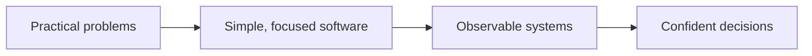

# Quantum Axis

### The Axis of Infinite Intelligence

**We build practical software for complex systems.**

[Projects](#-our-work)　·　[Approach](#-how-we-build)　·　[Technology](#-technology)　·　[Contact](#-connect)

---

## ◈ Our work

We turn complex infrastructure into tools that feel clear, useful, and approachable. Our current focus is **network visibility**: helping teams understand connectivity, spot problems, and act with confidence.

<table>
<tr>
<td width="50%" valign="top">

### [Qnetward ↗](https://github.com/Quantum-Axis/Qnetward)

**Real-time network diagnostics. Self-hosted by design.**

Probe connectivity, inspect DNS, follow live latency, and keep searchable history in one workspace.

[Open the project](https://github.com/Quantum-Axis/Qnetward) · [Launch Qnetward](https://qnetward.moparapairayat.one)

</td>
<td width="50%" valign="top">

**DIAGNOSE** · ICMP, TCP, port scans, DNS 
**OBSERVE** · Live streams, charts, target health 
**OPERATE** · History, exports, alerts, workspaces 
**OWN** · Self-hosted API, dashboard, and data

</td>
</tr>
</table>

## ◉ Our Team

<table width="100%">
<tr>
<td align="center" width="25%">
   
  <strong><a href="https://github.com/Fatemabintemariam">Fatema Binte Mariam</a></strong> 
  Qnetward contributor
</td>
<td align="center" width="25%">
   
  <strong><a href="https://github.com/Moparapairayat">Mopara Pair Ayat</a></strong> 
  Organization member
</td>
<td align="center" width="25%">
   
  <strong><a href="https://github.com/monabber444">Monabber Eaman</a></strong> 
  Qnetward contributor
</td>
<td align="center" width="25%">
   
  <strong><a href="https://github.com/OrhanAsantr">Orhan Asan</a></strong> 
  Qnetward contributor
</td>
</tr>
</table>

## ◉ How we build

We value clear interfaces, useful defaults, and infrastructure our users can control. Each project should make a real operational task easier to understand and complete.

## ⌘ Technology & Capability Stack

A broad organization-level map of the tools and domains we explore. Qnetward’s current production stack is called out separately below.

### ⚡ Core Engineering

`JavaScript` · `TypeScript` · `Python` · `Rust` · `Go` · `C++` · `C` · `Java` · `Kotlin` · `Swift` · `Dart` · `Scala` · `Lua` · `Haskell`

### 🧩 Frontend · Web Experience

`React` · `Next.js` · `Vue` · `Nuxt` · `Svelte` · `Astro` · `Tailwind CSS` · `Three.js` · `GraphQL` · `Webpack` · `Vite` · `Redux`

`WebGPU` · `Motion UI` · `Edge Rendering` · `Streaming UI` · `Reactive Systems`

### 🧠 AI · AGI · Autonomous Systems

`Python` · `TensorFlow` · `PyTorch` · `OpenCV` · `scikit-learn`

`OpenAI` · `Gemini` · `Claude` · `LangChain` · `LlamaIndex` · `CrewAI` · `AutoGen` · `AI Agents` · `Multi-Agent Systems` · `RAG Pipelines` · `Fine Tuning` · `Prompt Engineering` · `Agentic Workflows` · `LLMOps` · `Neural Search` · `Multimodal AI` · `Evals` · `Model Monitoring` · `Edge AI`

### ☁️ Cloud Native · Platform Engineering

`AWS` · `Google Cloud` · `Azure` · `Cloudflare` · `Docker` · `Kubernetes` · `Terraform` · `Linux` · `Nginx` · `Prometheus` · `Grafana` · `Jenkins`

`Cloud Native` · `Microservices` · `Event Driven` · `Service Mesh` · `GitOps` · `DevSecOps` · `Observability` · `OpenTelemetry` · `Edge Computing` · `Serverless` · `Cost Optimization` · `Incident Response` · `Release Automation`

### 🗄️ Distributed Data Systems

`PostgreSQL` · `MySQL` · `MongoDB` · `Redis` · `Firebase` · `Cassandra` · `Elasticsearch` · `Kafka` · `RabbitMQ` · `Supabase` · `SQLite`

`Vector Databases` · `Qdrant` · `Neo4j` · `NATS` · `Apache Spark` · `Data Lakes` · `Pinecone` · `Weaviate`

### 🔐 Cybersecurity · Zero Trust

`Linux` · `Cloudflare` · `Docker` · `GitHub Actions`

`Zero Trust` · `OWASP` · `Threat Modeling` · `Penetration Testing` · `Encryption` · `OAuth 2.0` · `JWT` · `WAF` · `Supply Chain Security` · `Secrets Hygiene` · `IAM Boundaries`

### ⚡ EEE · Embedded AI · Cyber-Physical Systems

`C` · `C++` · `Rust` · `Python` · `Arduino` · `Raspberry Pi` · `Linux` · `OpenCV` · `ROS`

`STM32` · `ESP32` · `FreeRTOS` · `Zephyr RTOS` · `UART` · `I2C` · `SPI` · `CAN Bus` · `MQTT` · `LoRaWAN` · `BLE` · `Zigbee` · `TinyML` · `TensorFlow Lite Micro` · `NVIDIA Jetson` · `ROS 2` · `SLAM` · `Sensor Fusion` · `Kalman Filter` · `PID Control` · `MATLAB` · `Simulink` · `KiCad` · `Altium` · `LTspice` · `Power Electronics` · `Smart Grid` · `Battery Management Systems`

### 🌐 Web3 · Robotics · XR · Creative Engineering

`Solidity` · `Arduino` · `Raspberry Pi` · `Linux` · `Three.js` · `Unity` · `Unreal Engine` · `Godot` · `Blender` · `Figma` · `Photoshop` · `Illustrator` · `After Effects` · `Premiere Pro`

`Smart Contracts` · `Layer 2` · `DAO` · `Embedded` · `Edge AI` · `Automation` · `WebXR` · `Simulation` · `Spatial Computing` · `Design Systems` · `UI Motion` · `Generative Design`

### 🧰 Developer Arsenal

`Git` · `GitHub` · `GitLab` · `Postman` · `VS Code` · `IntelliJ IDEA` · `Vercel` · `PowerShell` · `Docker`

`Jira` · `Notion` · `Confluence` · `Prettier` · `ESLint` · `Platform Engineering`

<strong>🧪 Future Tech Research Radar</strong>

`WebGPU Compute` · `On-Device AI` · `Autonomous Agents` · `Spatial Interfaces` · `Privacy-Preserving Systems` · `Next-Generation Networks`

**Qnetward today:** Go probe engine and API · Next.js / React / TypeScript dashboard · PostgreSQL / TimescaleDB · optional Redis cache · S3-compatible object storage · Docker Compose deployment.
## ↗ Explore Qnetward

| Resource | What you’ll find |
|:--|:--|
| [Live site](https://qnetward.moparapairayat.one) | The Qnetward dashboard |
| [Source code](https://github.com/Quantum-Axis/Qnetward) | Application code and releases |
| [Project README](https://github.com/Quantum-Axis/Qnetward#readme) | Setup, CLI, API, deployment, and safety notes |
| [Architecture decisions](https://github.com/Quantum-Axis/Qnetward/tree/main/docs/adr) | Design choices and their context |

## ⌁ Connect

Questions, ideas, or collaboration inquiries? [Email Quantum Axis](mailto:quantumaxisltd@gmail.com).

---

QUANTUM AXIS　·　Independent ideas. Useful software. Built with intent.

