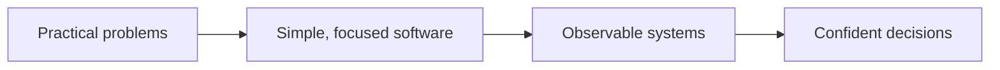

# Quantum Axis

### The Axis of Infinite Intelligence

**We build practical software for complex systems.**

[Projects](#-our-work)　·　[Approach](#-how-we-build)　·　[Technology](#-technology)　·　[Contact](#-connect)

---

## ◈ Our work

We turn complex infrastructure into tools that feel clear, useful, and approachable. Our current focus is **network visibility**: helping teams understand connectivity, spot problems, and act with confidence.

<table>
<tr>
<td width="50%" valign="top">

### [Qnetward ↗](https://github.com/Quantum-Axis/Qnetward)

**Real-time network diagnostics. Self-hosted by design.**

Probe connectivity, inspect DNS, follow live latency, and keep searchable history in one workspace.

[Open the project](https://github.com/Quantum-Axis/Qnetward) · [Launch Qnetward](https://qnetward.moparapairayat.one)

</td>
<td width="50%" valign="top">

**DIAGNOSE** · ICMP, TCP, port scans, DNS 
**OBSERVE** · Live streams, charts, target health 
**OPERATE** · History, exports, alerts, workspaces 
**OWN** · Self-hosted API, dashboard, and data

</td>
</tr>
</table>

## ◉ Our Team

<table width="100%">
<tr>
<td align="center" width="25%">
   
  <strong><a href="https://github.com/Fatemabintemariam">Fatema Binte Mariam</a></strong> 
  Qnetward contributor
</td>
<td align="center" width="25%">
   
  <strong><a href="https://github.com/Moparapairayat">Mopara Pair Ayat</a></strong> 
  Organization member
</td>
<td align="center" width="25%">
   
  <strong><a href="https://github.com/monabber444">Monabber Eaman</a></strong> 
  Qnetward contributor
</td>
<td align="center" width="25%">
   
  <strong><a href="https://github.com/OrhanAsantr">Orhan Asan</a></strong> 
  Qnetward contributor
</td>
</tr>
</table>

## ◉ How we build

We value clear interfaces, useful defaults, and infrastructure our users can control. Each project should make a real operational task easier to understand and complete.

## ⌘ Technology

Qnetward pairs a **Go** backend and probe engine with a **Next.js / TypeScript** dashboard. **PostgreSQL / TimescaleDB** stores durable history; **Redis** and S3-compatible storage support deployments that need them.

## ↗ Explore Qnetward

| Resource | What you’ll find |
|:--|:--|
| [Live site](https://qnetward.moparapairayat.one) | The Qnetward dashboard |
| [Source code](https://github.com/Quantum-Axis/Qnetward) | Application code and releases |
| [Project README](https://github.com/Quantum-Axis/Qnetward#readme) | Setup, CLI, API, deployment, and safety notes |
| [Architecture decisions](https://github.com/Quantum-Axis/Qnetward/tree/main/docs/adr) | Design choices and their context |

## ⌁ Connect

Questions, ideas, or collaboration inquiries? [Email Quantum Axis](mailto:quantumaxisltd@gmail.com).

---

QUANTUM AXIS　·　Independent ideas. Useful software. Built with intent.

